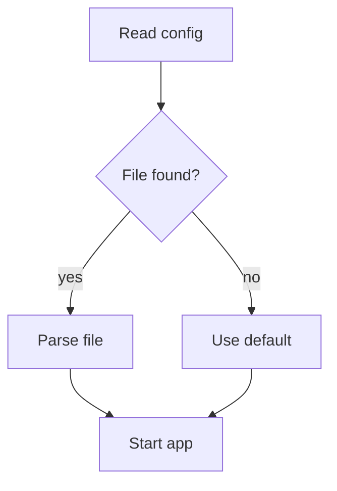

# Diagrams

Patterns for technical drawings. Every block here passes `check.mjs`. Copy the shape, change the labels, run the checker again.

Contents: [Rules](#rules) · [Flowchart](#flowchart) · [Layers](#layers) · [Sequence](#sequence) · [State machine](#state-machine) · [Pipeline](#pipeline) · [Before and after](#before-and-after) · [Timeline](#timeline) · [Bit layout](#bit-layout) · [Tree](#tree) · [When to use Mermaid](#when-to-use-mermaid)

## Rules

- **Direction.** Steps with branches go top to bottom. Short chains (3 to 5 steps) go left to right. Top to bottom also fits narrow places like code comments.
- **Boxes first, lines second.** Fix every box's left column and width, then draw the connectors.
- **Odd widths.** A box 15 wide (borders included) has a middle at `left + 7`. Even widths have no middle.
- **Label the line, not the box.** Put `yes`, `no`, `HTTPS` beside the connector.
- **A `┼` means the lines join.** If two lines only cross, move one. If you cannot, leave a gap in the horizontal line on each side of the vertical one.
- **Arrowheads point at the thing that receives.** Use one family per drawing: `▶ ◀ ▲ ▼`, or `> < ^ v` in ASCII.

The drift the checker catches, a split one column off its stem:

```text fail
   ┌────────┐
   │ Check  │
   └───┬────┘
        │
   ┌────┴────┐
```

`check.mjs` says `'┬' goes down, but the line below is one column right`. The box is 10 wide, so it has no middle. Make it 9 or 11 wide and move the stem.

## Flowchart

```text
        ┌─────────────┐
        │ Read config │
        └──────┬──────┘
               │
               ▼
        ┌─────────────┐
        │ File found? │
        └──────┬──────┘
           yes │ no
       ┌───────┴───────┐
       ▼               ▼
┌─────────────┐ ┌─────────────┐
│ Parse file  │ │ Use default │
└──────┬──────┘ └──────┬──────┘
       └───────┬───────┘
               ▼
        ┌─────────────┐
        │  Start app  │
        └─────────────┘
```

How the columns were worked out: the stem is column 15. Top boxes are 15 wide, so they start at column 8 (`8 + 7 = 15`). The split arms reach 8 columns each way, to 7 and 23. The bottom boxes are centred on those.

## Layers

For "what talks to what". Each layer is one wide box, and the connectors cross between layers on `┬` and `┴`.

```text
┌─────────────────────────────────────┐
│ Browser                             │
│   ┌────────────┐   ┌────────────┐   │
│   │ React UI   │──▶│ Store      │   │
│   └────────────┘   └────────────┘   │
└──────────────────┬──────────────────┘
                   │ HTTPS
┌──────────────────┴──────────────────┐
│ Server                              │
│   ┌────────────┐   ┌────────────┐   │
│   │ API routes │──▶│ Auth       │   │
│   └────────────┘   └────────────┘   │
└──────────────────┬──────────────────┘
                   │ SQL
┌──────────────────┴──────────────────┐
│ Postgres                            │
└─────────────────────────────────────┘
```

## Sequence

Who sends what, in time order, top to bottom. One lifeline per actor, straight down from the middle of its box.

```text
┌─────────┐     ┌─────┐       ┌──────────┐
│ Browser │     │ API │       │ Database │
└────┬────┘     └──┬──┘       └────┬─────┘
     │ POST /login │               │
     │────────────▶│               │
     │             │ SELECT user   │
     │             │──────────────▶│
     │             │◀──────────────│
     │             │ 1 row         │
     │◀────────────│               │
     │ 200, cookie │               │
```

## State machine

States are boxes, events are labels on the arrows. Show the way back from failure, it is usually the point of the drawing.

```text
            ┌───────┐  start   ┌─────────┐  done   ┌──────┐
 ─────────▶ │ Idle  │ ───────▶ │ Running │ ──────▶ │ Done │
            └───────┘          └────┬────┘         └──────┘
                ▲                   │ error
                │   retry      ┌────▼────┐
                └──────────────┤ Failed  │
                               └─────────┘
```

## Pipeline

```text
┌───────┐   ┌──────────┐   ┌──────┐
│ parse │──▶│ validate │──▶│ load │
└───────┘   └────┬─────┘   └──────┘
                 │ bad rows
                 ▼
            rejects.log
```

## Before and after

Stack them. Side by side doubles the width and rarely fits.

```text
BEFORE  each page fetches on its own

  Home ──▶ fetch('/api/cart')
  Cart ──▶ fetch('/api/cart')
  User ──▶ fetch('/api/user')

AFTER  one client, one place for auth and retries

  Home ──┐
  Cart ──┼──▶ apiClient ──▶ /api
  User ──┘
```

## Timeline

```text
  2024        2025             2026
──┬───────────┬────────────────┬──────▶
  │           │                │
  v1.0        v2.0             v3.0 beta
  first ship  plugins          new engine
```

## Bit layout

The style RFCs use for packet headers. Each bit gets 4 columns, so the bit numbers line up over the cells. This one was generated with a few lines of script, which beats counting 65 columns by hand.

```text
 15  14  13  12  11  10   9   8   7   6   5   4   3   2   1   0
┌───┬───┬───────────────┬───────────────────────────────────────┐
│ R │ W │     MODE      │                 COUNT                 │
└───┴───┴───────────────┴───────────────────────────────────────┘
```

## Tree

Never by hand. The `│` has to stop exactly where the last child is, and models get that wrong.

```bash
printf 'src\n  app\n    page.tsx\n    layout.tsx\n  lib\n    db.ts\n' | node scripts/layout.mjs tree
find src -type f | node scripts/layout.mjs tree --paths
```

```text
src
├── app
│   ├── page.tsx
│   └── layout.tsx
└── lib
    └── db.ts
```

For real folders, `tree` (if installed) does the same: `tree --charset ascii -I node_modules`.

## When to use Mermaid

Text diagrams win when the reader sees the source: code comments, terminals, commit messages, diffs. Mermaid wins when the place renders it (GitHub, GitLab and many docs sites do) and the graph is big: more than about 12 boxes, or lines that would cross.



Not sure where it will be read? Draw it in text. It works everywhere.
